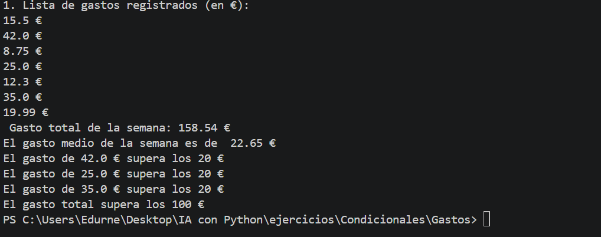
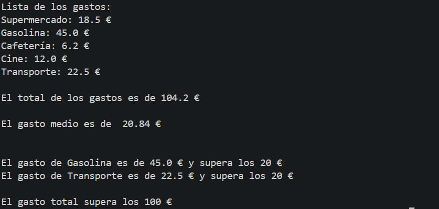

### RETO: MI GESTOR DE GASTOS

Vas a crear un programa llamado mi_gestor_gastos.py que ayude a una persona a entender sus gastos semanales.
El programa trabajará con datos ficticios y deberá permitir:
1. Guardar varios gastos en una lista.
2. Calcular el total de los gastos.
3. Calcular el gasto medio.
4. Mostrar qué gastos superan los 20 €.
5. Mostrar un mensaje indicando si el gasto total supera un presupuesto semanal de 100 €.

## Entregables individuales
- Un archivo mi_gestor_gastos.py.
- Una captura o salida de ejemplo del programa funcionando.
- Una breve explicación: qué hace el programa, qué concepto le resultó más difícil y cómo lo resolvió.
- Un repositorio de GitHub

## RETO 1: RESULTADO

## NIVEL 2 - Escribe el programa desde cero usando esta lista de comprobación:
- Define una lista de cinco gastos.
- Calcula el total con un bucle.
- Calcula la media.
- Utiliza una condición para mostrar los gastos superiores a 20 €.
- Compara el total con el presupuesto de 100 €.
- Organiza al menos una 

## RETO 2: RESULTADO

## NIVEL 3: Añade dos mejoras:
- Crea una función calcular_total(gastos) que devuelva el total.
- Permite que la persona introduzca un límite para filtrar los gastos.
Si terminas antes, prueba qué ocurre con una lista vacía y explica cómo evitar un error al calcular la media.